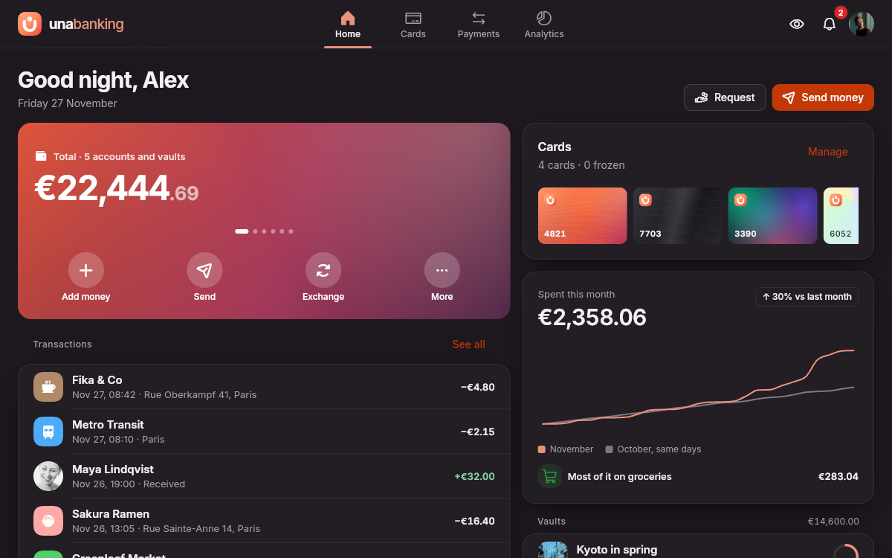
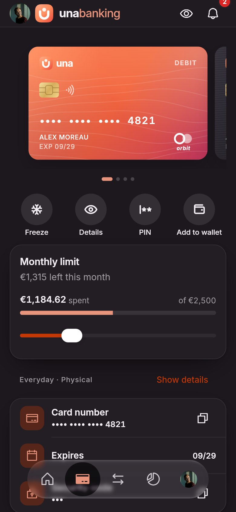

# Una Banking

A fictional money app — accounts in five currencies, cards you can freeze
and reveal, payments between friends, exchange, analytics and savings
vaults — built entirely from the widgets of
[una](https://github.com/vlidholt/una), a Flutter UI package.

**Try it:** <https://vlidholt.github.io/una_banking/>

<p>
  
  
</p>

It is one of the example apps that show what una looks like in a real
product. Everything adapts: a desktop gets a top bar with the five pages
and dashboards of two columns; a phone gets a floating bottom bar, flows
in sheets and cards to swipe through. On an iPhone, iPad or Mac the bars,
sheets and menus are Liquid Glass; Profile turns it off to show what every
other platform gets, and switches between dark (the app's own look) and
light.

## What is in it

- **Home** — everything you hold, then each account in its currency,
  swiped through on the balance; Add money, Send, Exchange and More; the
  latest transactions; this month's spending charted day by day against
  last month's to the same day; cards and savings vaults.
- **Cards** — physical, metal, virtual and single-use cards drawn in code,
  each with its own design and the app's own (fictional) network. Freeze
  one and it frosts over; show its number, expiry and security code and
  copy them; set the monthly limit; choose what it may be used for;
  change the PIN; order a new card.
- **Payments** — send to the people you pay with a keypad, a note and a
  review; request money and see who still owes you; scheduled payments;
  exchange between accounts at the mid-market rate over its chart.
- **Analytics** — spending by category as a donut, six months side by
  side, budgets that fill and turn red, and subscriptions with their next
  charge.
- **A transaction** — where (on a little map drawn in code), when, which
  card, its category to change, a bill to split with friends.
- **Vaults** — savings goals with their photos, progress rings, round-ups
  and money in and out.
- **Profile** — your plan, appearance (theme, Liquid Glass, hidden
  balances, text size), two-step verification and the devices signed in,
  notifications and help.

Every flow works end to end in memory: send money and the balance, the
statement and the notifications change; nothing ever leaves the app.
`?tab=cards` (or `payments`, `analytics`, `profile`) opens on a page.

## The look

The package's default style (Fluid) on its own colours:
`ColorScheme.fromSeed` with a warm coral (`#F2643D`) and warm graphite
greys, dark by default, set in Inter with tabular figures for every
amount. The logo is drawn in code (`lib/widgets/logo.dart`) and the web
icons are rendered from it
(`UPDATE_APP_ICONS=1 flutter test test/app_icons_test.dart`); so are the
cards (`lib/widgets/bank_card.dart`) and the merchants' logos.

The photographs are from Unsplash; see
[assets/images/README.md](assets/images/README.md) for the credits. Every
person, company, card network and number in the app is fictional.

## Running it

```bash
flutter pub get
flutter run -d chrome
```

To work against a local checkout of una, put a `pubspec_overrides.yaml`
beside `pubspec.yaml` (it is gitignored):

```yaml
dependency_overrides:
  una:
    path: ../una
```

`flutter test` runs the suite; `flutter analyze` and
`dart format --set-exit-if-changed lib test` are what CI checks besides.

## Licence

MIT; see [LICENSE](LICENSE). The photographs are under the Unsplash
License.
